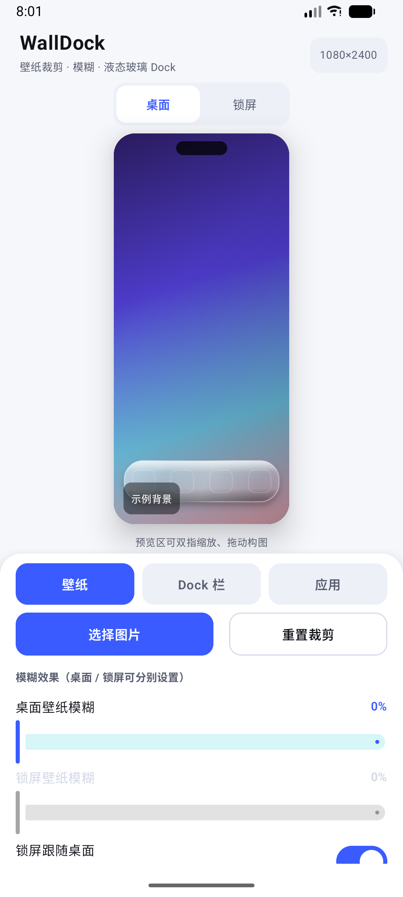
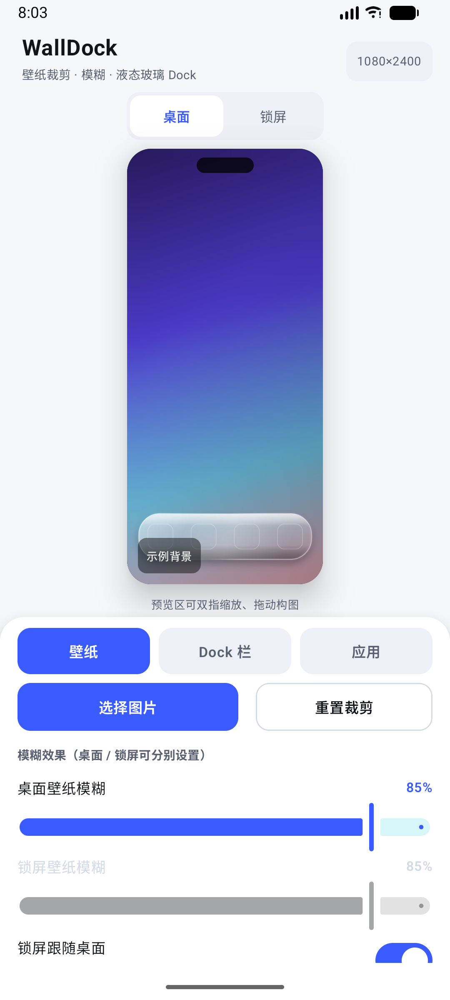
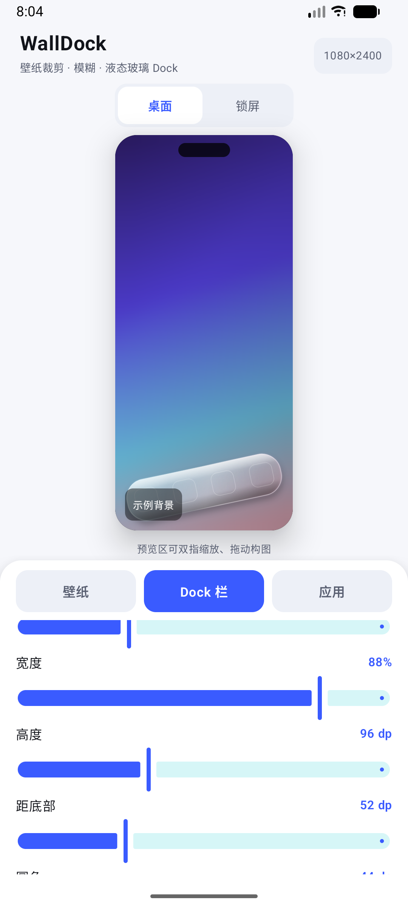
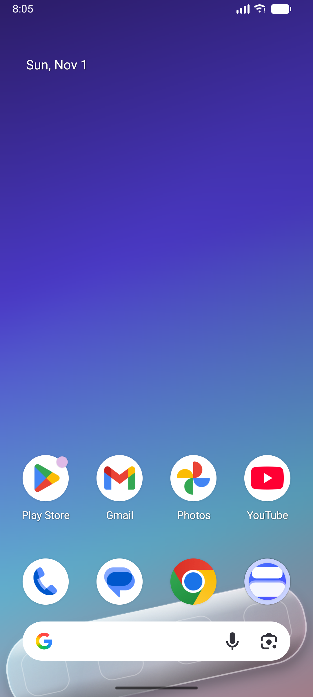

# WallDock — 壁纸裁剪 · 模糊 · 液态玻璃 Dock

为 Redmi K80 / 澎湃 OS（HyperOS）等机型打造的壁纸定制工具：选图 → 裁剪构图 → 分别设置桌面/锁屏模糊 → 叠加一条可调角度、宽度、高度、透明度的玻璃 Dock 栏 → 一键写入系统壁纸。

---

## 功能

**壁纸**
- 系统相册选图（Photo Picker，无需相册权限）
- 预览区直接双指缩放 / 拖动构图，等价于自由裁剪，附三分构图线
- 输出分辨率自动匹配设备真实屏幕（K80 为 1440×3200）

**模糊**
- 桌面壁纸模糊、锁屏壁纸模糊可**分别**调节（0–100%）
- 可开关「锁屏跟随桌面」
- 纯 Kotlin 实现的三次盒式模糊（等价高斯），无需 RenderScript，全版本一致

**Dock 栏**
- 玻璃样式：**磨砂 / 液态玻璃 / 通透**
- 底图来源：**模糊壁纸** 或 **原图**（决定玻璃后面透出哪一层）
- 角度（-30°~30°，可倾斜）、宽度（屏宽占比）、高度、距底部距离、圆角
- 透明度、玻璃后方附加模糊强度
- 图标位数量（0–6）与「对位参考框」，方便把启动器图标摆到 Dock 上

**应用**
- 一键应用到「桌面 + 锁屏」，也可只设桌面或只设锁屏

---

## 设计说明：Dock 是怎么"显示在壁纸上"的

Android 不允许普通 App 往别家启动器的桌面上画东西，所以这里采用**把 Dock 烘焙进壁纸**的方案：

1. 按屏幕尺寸渲染裁剪后的底图；
2. 按需要生成模糊层；
3. 在独立图层上旋转、裁剪圆角、绘制玻璃（底图 → 白色薄涂层 → 上亮下暗渐变 → 斜向高光 → 上边缘内高光 → 下边缘内阴影 → 噪点 → 描边），再合成回壁纸。

好处是**任何启动器、任何图标布局都能看到这条 Dock**，而且是真正的"液态玻璃"质感（高光、色散描边、投影都与壁纸内容对齐）。
代价是 Dock 是静态的，不能点击——它的作用是视觉容器，真实图标由启动器摆上去，所以提供了「图标对位参考」。

---

## 编译

环境：JDK 17 + Android SDK（platform 35 / build-tools 35）。

```bash
# 方式一：Android Studio 打开工程目录，直接 Run
# 方式二：命令行
./gradlew :app:assembleDebug        # 产物 app/build/outputs/apk/debug/app-debug.apk
./gradlew :app:assembleRelease      # 已签名 release 包（需 keystore.properties）
```

> 首次构建需要联网从 Google Maven 拉取 Compose 依赖，约 2–3 分钟。

release 签名读取根目录的 `keystore.properties`（不在仓库里，涉及私钥）；该文件不存在时会自动退回 debug 签名，所以任何人 clone 下来都能直接构建。

### 直接安装（不想编译）

👉 **[下载 WallDock v1.0.0（签名版 APK，18 MB）](../../releases/latest)**

仓库里也留了一份副本：[`release/WallDock-v1.0.0.apk`](release/WallDock-v1.0.0.apk)（SHA-256 见同名 `.sha256` 文件）

传到手机上点开安装即可（需允许「安装未知来源应用」），或用 adb：

```bash
adb install -r release/WallDock-v1.0.0.apk
```

> 该 APK 使用自签名证书（`CN=WallDock`）签名，非 Google Play 分发，属正常情况。

## 界面

| 编辑器 | 桌面模糊 85% |
| :---: | :---: |
|  |  |

| Dock 倾斜 -12° | 应用到桌面后 |
| :---: | :---: |
|  |  |

---

## 澎湃 OS / HyperOS 注意事项

| 现象 | 处理方式 |
| --- | --- |
| 锁屏壁纸设置后没变化 | 设置 → 锁屏 → 关闭「锁屏画报」；或关闭锁屏动态壁纸 |
| 桌面壁纸被系统再次裁切 | 系统壁纸设置里把「滚动」关掉，保持静态壁纸 |
| Dock 与启动器图标对不齐 | 打开「显示图标对位参考」，把启动器 Dock 图标移到参考框上；或在桌面设置里把「图标大小」调到默认 |
| 想彻底替换 Dock 外观 | 配合第三方启动器（如 Nova / Lawnchair）把自带 Dock 背景关掉，只留本 App 烘焙的这条 |

---

## 工程结构

```
app/src/main/java/com/walldock/app/
├── model/EditorState.kt        裁剪/模糊/Dock 参数模型
├── img/
│   ├── Blur.kt                 降采样 + 三次分离盒式模糊
│   ├── BitmapUtils.kt          EXIF 解码、cover 裁剪矩阵、示例图
│   └── DockRenderer.kt         玻璃 Dock 渲染（磨砂/液态/通透）
├── util/
│   ├── Screen.kt               真实屏幕像素尺寸
│   └── WallpaperSetter.kt      WallpaperManager 封装（FLAG_SYSTEM / FLAG_LOCK）
├── vm/EditorViewModel.kt       状态 + 预览渲染（防抖） + 全尺寸应用
└── ui/
    ├── EditorScreen.kt         编辑器主界面
    ├── components/Controls.kt  滑杆/开关/分段选择
    └── theme/Theme.kt
```

关键实现点：

- 预览在 480px 宽的小图上渲染并做 40ms 防抖，拖滑杆不卡；
- 点击应用时才按真实屏幕尺寸重新渲染，最终位图直接交给 `WallpaperManager.setBitmap(..., FLAG_SYSTEM/FLAG_LOCK)`；
- `android:largeHeap="true"` 保证大尺寸多图层合成时不会 OOM。
