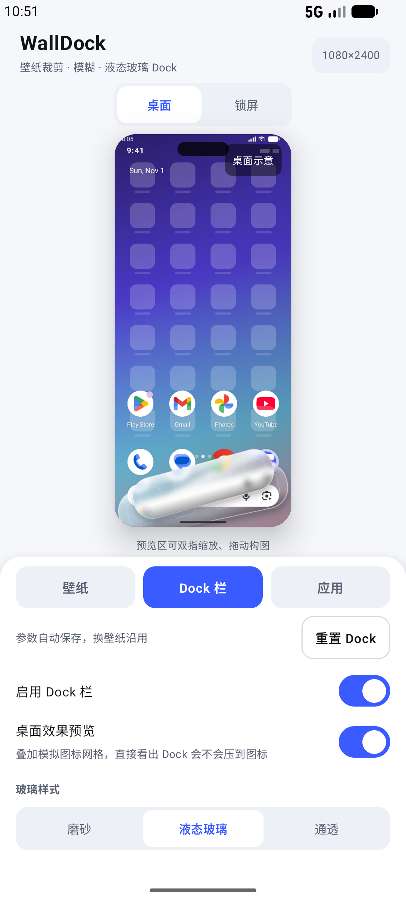
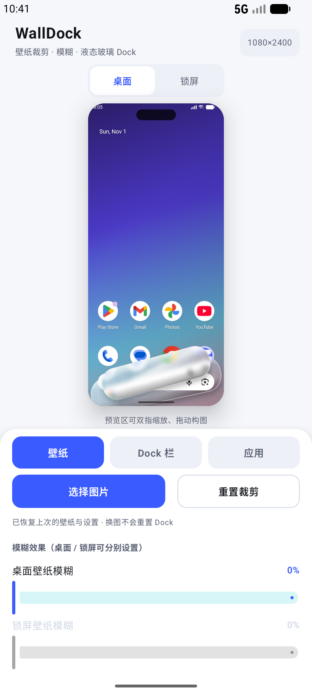

# WallDock

**壁纸裁剪 · 分层模糊 · 液态玻璃 Dock 栏** —— 为 Redmi K80 / 澎湃 OS 等机型做的壁纸定制工具。

选图 → 拖动构图 → 分别设置桌面 / 锁屏模糊 → 叠加一条可调角度、宽度、高度、透明度的玻璃 Dock → 一键写入系统壁纸。

<p>


</p>

<p>



</p>

---

## 目录

- [下载安装](#下载安装)
- [快速上手](#快速上手)
- [功能](#功能)
- [参数速查](#参数速查)
- [更多截图](#更多截图)
- [常见问题](#常见问题)
- [Dock 为什么能显示在壁纸上](#dock-为什么能显示在壁纸上)
- [从源码构建](#从源码构建)
- [隐私](#隐私)
- [工程结构](#工程结构)
- [版本历史](#版本历史)

---

## 下载安装

👉 **[前往 Releases 下载最新版](https://github.com/Summer-Ever/WallDock/releases/latest)**

| 文件 | 签名 | 大小 | 适合谁 |
| --- | --- | --- | :--- |
| `WallDock-v1.2.1.apk` | 正式签名 | 18.2 MB | **推荐**。全新安装，或之前装的是正式版 |
| `WallDock-v1.2.1-debugkey.apk` | 调试签名 | 22.6 MB | 之前装的是最早那版调试包、升级时提示「签名不同」的用户 — **可直接覆盖，保留已调参数** |

<details>
<summary>校验值（SHA-256）</summary>

```
9a1bf79158a1a117e00436cd8b64fd049c6d8f98b24ef1c3406a731b8d78e68a  WallDock-v1.2.1.apk
946e36079e89b55245aff7a2464566d19945a5ae709560ec475533e4b5e44ebe  WallDock-v1.2.1-debugkey.apk
```

</details>

安装：把 APK 传到手机点开安装（需允许「安装未知来源应用」），或用 adb：

```bash
adb install -r WallDock-v1.2.1.apk
```

> 该 APK 使用自签名证书（`CN=WallDock`）签名，不走 Google Play 分发，属正常情况。
> 仓库 `release/` 目录也留了副本，但**请以 Releases 页面的包为准**。

---

## 快速上手

1. **选图** —— 点「选择图片」，走系统相册选择器，不申请任何存储权限。还没选图时会先显示一张内置示例图，方便先试 Dock 手感。
2. **调构图** —— 在预览区双指缩放、单指拖动，等价于自由裁剪，可开三分构图线辅助。
3. **调模糊与 Dock** —— 「壁纸」页里分别拉桌面 / 锁屏的模糊强度；「Dock 栏」页调角度、宽度、圆角、材质。打开「桌面效果预览」能直接看到启动器图标会不会被 Dock 压住。
4. **应用** —— 「应用」页选「桌面 + 锁屏」或只设其中一侧。

> 所有参数（含上次的壁纸与构图）都会自动记住，下次打开 App 直接接着上次用。

---

## 功能

**壁纸**
- 系统相册选图（Photo Picker，无需相册权限）
- 预览区直接双指缩放 / 拖动构图，附三分构图线
- 裁剪**实时跟手**：手势期间走 GPU 图形变换不重绘，松手后再合成模糊与 Dock
- 输出分辨率匹配设备真实屏幕（K80 为 1440×3200）

**模糊**
- 桌面壁纸、锁屏壁纸模糊可**分别**调节（0–100%）
- 可开「锁屏跟随桌面」
- 纯 Kotlin 三次盒式模糊（等价高斯），不依赖 RenderScript，各版本表现一致
- 大半径自动降采样，K80 全尺寸合成也在 1 秒内

**Dock 栏**
- 玻璃样式：**磨砂 / 液态玻璃 / 通透**
- 底图来源：**模糊壁纸** 或 **原图**（决定玻璃后面透出哪一层）
- 角度、宽度、高度、距底部、圆角、透明度、玻璃后方模糊强度
- 图标位数量（0–6）与「对位参考框」，方便把启动器图标摆到 Dock 上
- **桌面效果预览**：预览里叠加模拟启动器（状态栏 / 4 列图标 / 页码点），图标止步于 Dock 上方

**应用**
- 一键应用到「桌面 + 锁屏」，也可只设桌面或只设锁屏
- **参数常态化**：Dock 参数、模糊强度、上次壁纸与构图全部自动落盘；Dock 页有「重置 Dock」，壁纸页有「重置裁剪」

---

## 参数速查

| 参数 | 范围 | 默认 | 说明 |
| --- | :---: | :---: | --- |
| 样式 | 磨砂 / 液态 / 通透 | 液态玻璃 | 通透=几乎纯色散描边，磨砂=重噪点+强模糊 |
| 底图来源 | 模糊壁纸 / 原图 | 模糊壁纸 | 玻璃透出哪一层画面 |
| 角度 | -30° ~ 30° | 0° | 负值左倾，正值右倾 |
| 宽度 | 45% ~ 98% | 88% | 占屏宽比例 |
| 高度 | 56 ~ 170 dp | 96 dp | Dock 条高度 |
| 距底部 | 0 ~ 180 dp | 52 dp | 往上调避开手势条 |
| 圆角 | 0 ~ 80 dp | 44 dp | 全圆角约需 ≥ 高度一半 |
| 透明度 | 0 ~ 100% | 42% | 玻璃底色不透明度 |
| 玻璃后方模糊 | 0 ~ 100% | 55% | 只影响 Dock 内部取样，不影响整张壁纸 |
| 图标位 | 0 ~ 6 | 4 | 只画对位参考框，不生成真图标 |

---

## 更多截图

| 编辑器 | 桌面壁纸模糊 85% | Dock 倾斜 -12° |
| :---: | :---: | :---: |
|  |  |  |

| 应用到桌面后 | 重开自动恢复上次会话 | 桌面效果预览 |
| :---: | :---: | :---: |
|  |  |  |

---

## 常见问题

<details>
<summary><b>锁屏壁纸设置后没变化</b></summary>

设置 → 锁屏 → 关闭「锁屏画报」；或关掉锁屏动态壁纸。澎湃 OS 的画报会覆盖第三方设置的锁屏壁纸。
</details>

<details>
<summary><b>桌面壁纸被系统又裁了一次 / 会跟着滑动</b></summary>

系统壁纸设置里把「滚动」关掉，保持静态壁纸；或在本 App 应用完成后不要再从系统相册重设一次壁纸。
</details>

<details>
<summary><b>Dock 和启动器图标对不齐</b></summary>

打开「显示图标对位参考」，把启动器的 Dock 图标挪到参考框上；同时把桌面设置里的「图标大小」调回默认，并确认启动器自身的 Dock 区域没有额外内边距。
</details>

<details>
<summary><b>想彻底替换掉启动器自带的 Dock 背景</b></summary>

配第三方启动器（Nova / Lawnchair 等）把自带 Dock 背景关掉，只留本 App 烘焙的这条。系统启动器不允许关闭 Dock 背景。
</details>

<details>
<summary><b>Dock 能点击吗？</b></summary>

不能。Dock 是画进壁纸里的静态图形，作用是视觉容器 —— 真实图标由启动器摆在上面，所以提供了对位参考框。
</details>

<details>
<summary><b>安装时提示「与已安装的应用签名不同」</b></summary>

说明手机上装的是最早那版调试包。改用 `WallDock-v1.2.1-debugkey.apk` 覆盖升级即可保留参数；之后想换成正式签名版需要卸载重装一次（参数会丢）。
</details>

---

## Dock 为什么能显示在壁纸上

Android 不允许普通 App 往别家启动器的桌面上画东西，所以这里采用**把 Dock 烘焙进壁纸**的方案：

1. 按屏幕尺寸渲染裁剪后的底图；
2. 按需要生成模糊层；
3. 在独立图层上旋转、裁圆角、绘制玻璃（底图 → 白色薄涂层 → 上亮下暗渐变 → 斜向高光 → 上边缘内高光 → 下边缘内阴影 → 噪点 → 描边），再合成回壁纸。

**好处**：任何启动器、任何图标布局都能看到这条 Dock，而且是真正的液态玻璃质感 —— 高光、色散描边、投影都与壁纸内容对齐。
**代价**：Dock 是静态的、不能点击；换壁纸或改 Dock 参数后需要重新「应用」一次。

---

## 从源码构建

环境：JDK 17 + Android SDK（platform 35 / build-tools 35）。

```bash
# 方式一：Android Studio 打开工程目录，直接 Run
# 方式二：命令行
./gradlew :app:assembleDebug        # 产物 app/build/outputs/apk/debug/app-debug.apk
./gradlew :app:assembleRelease      # 已签名 release 包（需 keystore.properties）
```

> 首次构建需联网从 Google Maven 拉取 Compose 依赖，约 2–3 分钟。

release 签名读取根目录 `keystore.properties`（不在仓库里，涉及私钥）；该文件不存在时**自动退回 debug 签名**，所以任何人 clone 下来都能直接构建。

技术栈：Kotlin 2.1.10 + Jetpack Compose（Material3），AGP 8.9.1，compileSdk 35 / minSdk 28，`largeHeap` 开启。

---

## 隐私

- 只声明了一个权限：`SET_WALLPAPER`（设置壁纸）。
- **没有网络权限**，App 不具备联网能力，不存在上传任何数据的可能。
- 图片全程在本地内存 / 私有目录处理，选图走系统 Photo Picker，不读取相册。

---

## 工程结构

```
app/src/main/java/com/walldock/app/
├── model/EditorState.kt        裁剪 / 模糊 / Dock 参数模型
├── img/
│   ├── Blur.kt                 降采样 + 三次分离盒式模糊
│   ├── BitmapUtils.kt          EXIF 解码、cover 裁剪矩阵、示例图
│   └── DockRenderer.kt         玻璃 Dock 渲染（磨砂 / 液态 / 通透）
├── util/
│   ├── Screen.kt               真实屏幕像素尺寸
│   └── WallpaperSetter.kt      WallpaperManager 封装（FLAG_SYSTEM / FLAG_LOCK）
├── data/SettingsStore.kt       参数持久化（SharedPreferences JSON + 壁纸缓存）
├── vm/EditorViewModel.kt       状态 + 预览渲染（合并式渲染循环） + 全尺寸应用 + 参数落盘
└── ui/
    ├── EditorScreen.kt         编辑器主界面（壁纸 / Dock 栏 / 应用 三页）
    ├── components/Controls.kt  滑杆 / 开关 / 分段选择
    └── theme/Theme.kt
```

关键实现点：

- 预览在 720px 宽的降采样图上渲染，`requestRender()` 是合并式渲染循环 —— 连续拖滑杆不会堆积渲染任务；
- 手势期间用 `graphicsLayer` 做 GPU 变换、零重绘，松手后**先渲染完成再撤层**，避免跳变；
- 点击应用时才按真实屏幕尺寸重新渲染，`WallpaperManager.setBitmap(..., FLAG_SYSTEM/FLAG_LOCK)` 直接写入；
- 参数改动 350 ms 防抖落盘，壁纸存 `filesDir/last_wallpaper.jpg`（最长边 2400，JPEG q92）；
- `android:largeHeap="true"` 保证大尺寸多图层合成不 OOM。

---

## 版本历史

| 版本 | 内容 | 链接 |
| :---: | --- | :---: |
| **v1.2.1** | 修复选图"延迟一张"、裁剪松手抖动 | [Notes](RELEASE_NOTES_v1.2.1.md) · [Release](https://github.com/Summer-Ever/WallDock/releases/tag/v1.2.1) |
| v1.2.0 | 桌面效果预览、裁剪实时跟手、滑杆连续刷新 | [Notes](RELEASE_NOTES_v1.2.0.md) |
| v1.1.0 | 参数常态化：Dock 设置与壁纸自动记住 | [Notes](RELEASE_NOTES_v1.1.0.md) |
| v1.0.0 | 首个可用版本 | [Notes](RELEASE_NOTES_v1.0.0.md) |

---

## 反馈

有 Bug 或想法请开 [Issue](https://github.com/Summer-Ever/WallDock/issues)，附上机型、系统版本和复现步骤会更容易定位。

## 许可

本仓库未附带开源许可证（All rights reserved）。欢迎克隆自用、阅读实现；如需再分发或商用请先联系作者。
